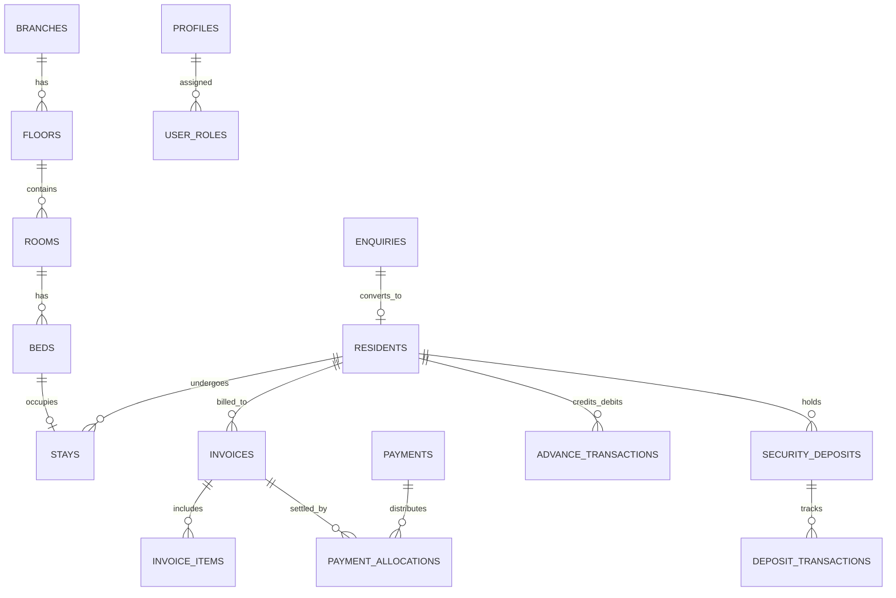

# 04. DATABASE SCHEMA — VARAHI GIRLS HOSTEL

## 1. Schema Overview

The database uses PostgreSQL (managed via Supabase). All monetary amounts are stored as `NUMERIC(10,2)` to prevent floating-point rounding errors. All primary keys use `UUID` or `TEXT` (for branches and resident IDs), and all state changes track `created_at` and `updated_at`.

---

## 2. Entity-Relationship Diagram (Core Entities)

---

## 3. Comprehensive Table Specifications

### 3.1 `profiles`
Central user identity linking Supabase Auth users to real-world individuals.
- `id` (UUID, PK, references `auth.users(id)` ON DELETE CASCADE)
- `full_name` (TEXT NOT NULL)
- `email` (TEXT UNIQUE)
- `phone` (TEXT UNIQUE)
- `avatar_url` (TEXT)
- `created_at` (TIMESTAMPTZ DEFAULT NOW())
- `updated_at` (TIMESTAMPTZ DEFAULT NOW())

### 3.2 `user_roles`
Role-Based Access Control mapping.
- `id` (UUID, PK DEFAULT gen_random_uuid())
- `profile_id` (UUID NOT NULL, references `profiles(id)`)
- `role` (TEXT NOT NULL, CHECK: `'owner'`, `'branch_manager'`, `'accountant'`, `'warden'`, `'resident'`)
- `branch_id` (UUID, references `branches(id)` NULLABLE - NULL means global access)
- `created_at` (TIMESTAMPTZ DEFAULT NOW())

### 3.3 `branches`
Central registry for the 5 DEVI Hostels branches.
- `id` (UUID, PK DEFAULT gen_random_uuid())
- `branch_code` (INT UNIQUE NOT NULL, CHECK: `branch_code BETWEEN 1 AND 5`)
- `name` (TEXT NOT NULL)
- `gender_category` (TEXT NOT NULL, CHECK: `'boys'`, `'girls'`)
- `address_line1` (TEXT NOT NULL)
- `address_line2` (TEXT)
- `city` (TEXT DEFAULT 'Shamshabad, Hyderabad')
- `state` (TEXT DEFAULT 'Telangana')
- `pincode` (TEXT DEFAULT '501218')
- `contact_phone` (TEXT NOT NULL)
- `contact_email` (TEXT)
- `total_floors` (INT NOT NULL DEFAULT 4)
- `facilities` (TEXT[] DEFAULT '{}')
- `images` (TEXT[] DEFAULT '{}')
- `status` (TEXT DEFAULT 'active', CHECK: `'active'`, `'inactive'`)
- `created_at` (TIMESTAMPTZ DEFAULT NOW())
- `updated_at` (TIMESTAMPTZ DEFAULT NOW())

### 3.4 `floors`
Floor-level grouping inside each branch.
- `id` (UUID, PK DEFAULT gen_random_uuid())
- `branch_id` (UUID NOT NULL, references `branches(id)`)
- `floor_number` (INT NOT NULL, CHECK: `floor_number BETWEEN 0 AND 10`)
- `floor_name` (TEXT NOT NULL)
- `created_at` (TIMESTAMPTZ DEFAULT NOW())
- UNIQUE(`branch_id`, `floor_number`)

### 3.5 `rooms`
Rooms located on floors.
- `id` (UUID, PK DEFAULT gen_random_uuid())
- `branch_id` (UUID NOT NULL, references `branches(id)`)
- `floor_id` (UUID NOT NULL, references `floors(id)`)
- `room_number` (TEXT NOT NULL)
- `room_type` (TEXT NOT NULL, CHECK: `'1_sharing'`, `'2_sharing'`, `'3_sharing'`, `'4_sharing'`)
- `has_ac` (BOOLEAN DEFAULT FALSE)
- `has_attached_bathroom` (BOOLEAN DEFAULT TRUE)
- `monthly_rate_per_bed` (NUMERIC(10,2) NOT NULL)
- `created_at` (TIMESTAMPTZ DEFAULT NOW())
- UNIQUE(`branch_id`, `room_number`)

### 3.6 `beds`
Individual rentable units within rooms.
- `id` (UUID, PK DEFAULT gen_random_uuid())
- `room_id` (UUID NOT NULL, references `rooms(id)`)
- `bed_number` (TEXT NOT NULL)
- `status` (TEXT NOT NULL DEFAULT 'vacant', CHECK: `'vacant'`, `'occupied'`, `'reserved'`, `'maintenance'`)
- `created_at` (TIMESTAMPTZ DEFAULT NOW())
- UNIQUE(`room_id`, `bed_number`)

### 3.7 `enquiries`
Public multi-step admission enquiries.
- `id` (UUID, PK DEFAULT gen_random_uuid())
- `category` (TEXT NOT NULL, CHECK: `'student'`, `'airport_employee'`)
- `full_name` (TEXT NOT NULL)
- `phone` (TEXT NOT NULL)
- `email` (TEXT)
- `gender` (TEXT NOT NULL, CHECK: `'male'`, `'female'`)
- `emergency_contact_name` (TEXT NOT NULL)
- `emergency_contact_phone` (TEXT NOT NULL)
- `emergency_contact_relation` (TEXT NOT NULL)
- `preferred_branch_id` (UUID references `branches(id)`)
- `room_sharing_preference` (TEXT NOT NULL)
- `expected_joining_date` (DATE NOT NULL)
- `student_college_name` (TEXT)
- `student_course` (TEXT)
- `student_year` (TEXT)
- `student_parent_phone` (TEXT)
- `employee_company` (TEXT)
- `employee_designation` (TEXT)
- `employee_shift_timing` (TEXT)
- `employee_id_number` (TEXT)
- `status` (TEXT NOT NULL DEFAULT 'new', CHECK: `'new'`, `'contacted'`, `'visited'`, `'approved'`, `'rejected'`)
- `internal_remarks` (TEXT)
- `converted_resident_id` (TEXT)
- `created_at` (TIMESTAMPTZ DEFAULT NOW())
- `updated_at` (TIMESTAMPTZ DEFAULT NOW())

### 3.8 `resident_id_sequences`
Collision-safe sequence generator for permanent DEVI Resident IDs.
- `id` (INT PRIMARY KEY DEFAULT 1)
- `current_number` (BIGINT NOT NULL DEFAULT 0)
- `updated_at` (TIMESTAMPTZ DEFAULT NOW())

### 3.9 `residents`
Permanent resident profile and core accounting records.
- `id` (UUID, PK DEFAULT gen_random_uuid())
- `resident_id` (TEXT UNIQUE NOT NULL) -- Format: DV[1-5]-[1-6]-[00001+]
- `profile_id` (UUID references `profiles(id)`)
- `initial_branch_code` (INT NOT NULL)
- `initial_floor_number` (INT NOT NULL)
- `sequence_number` (INT NOT NULL)
- `category` (TEXT NOT NULL, CHECK: `'student'`, `'airport_employee'`)
- `full_name` (TEXT NOT NULL)
- `phone` (TEXT NOT NULL UNIQUE)
- `email` (TEXT)
- `gender` (TEXT NOT NULL)
- `aadhaar_last_four` (VARCHAR(4))
- `admission_date` (DATE NOT NULL)
- `billing_anchor_day` (INT NOT NULL, CHECK: `billing_anchor_day BETWEEN 1 AND 31`)
- `agreed_monthly_rent` (NUMERIC(10,2) NOT NULL)
- `status` (TEXT NOT NULL DEFAULT 'active', CHECK: `'active'`, `'inactive'`, `'suspended'`)
- `created_at` (TIMESTAMPTZ DEFAULT NOW())
- `updated_at` (TIMESTAMPTZ DEFAULT NOW())

### 3.10 `stays`
Active and historical physical allocations for residents.
- `id` (UUID, PK DEFAULT gen_random_uuid())
- `resident_id` (UUID NOT NULL references `residents(id)`)
- `branch_id` (UUID NOT NULL references `branches(id)`)
- `room_id` (UUID NOT NULL references `rooms(id)`)
- `bed_id` (UUID NOT NULL references `beds(id)`)
- `check_in_date` (DATE NOT NULL)
- `check_out_date` (DATE)
- `is_current` (BOOLEAN DEFAULT TRUE)
- `created_at` (TIMESTAMPTZ DEFAULT NOW())

### 3.11 `audit_logs`
Immutable compliance and security trail.
- `id` (UUID, PK DEFAULT gen_random_uuid())
- `actor_id` (UUID references `profiles(id)`)
- `action` (TEXT NOT NULL)
- `entity_type` (TEXT NOT NULL)
- `entity_id` (TEXT NOT NULL)
- `changes` (JSONB)
- `ip_address` (TEXT)
- `created_at` (TIMESTAMPTZ DEFAULT NOW())

---

## 4. Phase 1 Row-Level Security (RLS) Blueprint

1. **`branches`, `floors`, `rooms`, `beds`:** Public read access (`true`) for website enquiry rendering; write access restricted to role `owner` or `branch_manager` matching branch.
2. **`enquiries`:** Public insert allowed (`true`) for prospective residents submitting web forms; read/update restricted to authenticated staff (`owner`, `branch_manager`, `accountant`, `warden`).
3. **`residents`:** Residents can read only their own record (`profile_id = auth.uid()`); staff can view and manage residents.
